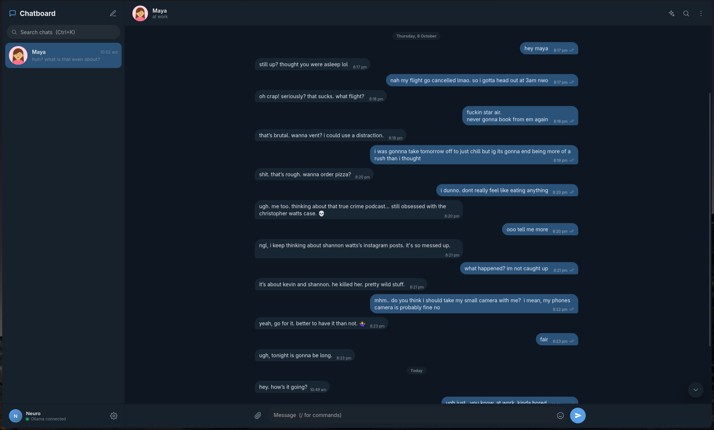

# Chatboard

Local messenger for local models. Text your Ollama models like you'd text friends.

Chatboard is a desktop-style chat app for [Ollama](https://ollama.com). Every contact is a persona with its own model, personality, picture, memory and chat thread, and you can put several of them in a group chat. Nothing leaves your machine except requests to your Ollama server.



## Features

**Chatting**
- Contacts text like actual friends: short, casual, multiple texts in a row, no assistant-speak. Built-in instructions are tuned for small 3-4B models.
- Group chats. Members talk to you *and to each other*. @mention (or just name) someone to get them to answer; `@everyone` pings all.
- **Nudge** button: a contact double-texts, or a group keeps talking without you.
- Streaming replies with typing indicators. Stop button. Regenerate the last reply.
- Replies keep generating if you reload or close the tab. They show up when you're back.
- Reply to (quote) messages, emoji reactions (double-click for ❤️), edit, delete, copy.
- Attach photos, PDFs, Word (.docx), text and code files (drag & drop, paste, or 📎). Document text is extracted and given to the model; photos go to vision models.
- Search inside a chat (Ctrl+F) and across chats (Ctrl+K), unread badges, pinned and muted chats, drafts per chat, chat export (txt/json), sounds.
- Type `/` in the composer for commands (`/search`, `/remind`).
- **Contacts text you first**: check-ins and little updates when it's been quiet (per contact: never / sometimes / often), never during your quiet hours, and never twice in a row without a reply.
- **Reminders**: "remind me to call mom at 6" and that contact texts you at 6. Manage them from the chat menu.
- **/search**: `/search weather in Mumbai` and the contact looks it up (DuckDuckGo or your own SearXNG) and answers in their own words, with sources. Pasted links get read too.
- Everyone knows the current time and how long it's been since you last talked.
- **Long-term memory**: facts are pulled out of your chats ("Ani has an interview at Google on Friday") and the relevant ones come back when they matter, matched by meaning with a small embedding model. View, add or delete them per contact. Plus short rolling conversation notes.
- Desktop notifications and sounds.

**Contacts**
- Starter personas (best friend, sibling, study buddy, roommate, mentor, night owl, game master).
- 21 built-in profile pictures, or upload your own.
- Styles: **Texting** (default), **Roleplay** (in-character, *actions*), or **Custom only** (your prompt, no built-in rules).
- Reply length, creativity (temperature), color, bio, status line.
- SillyTavern character card import (PNG, Character Card V2/V3).

**Customisation**
- 9 themes (Default, WhatsApp, Discord, Midnight, Paper, Sakura, Glass, Dracula, Synthwave) with light/dark/system modes.
- Custom accent color, bubble style (round / tails / flat), density, text size.
- Chat wallpaper with dim and blur sliders.
- Your profile (name, picture, "about you") is shared with your contacts.
- Instructions for everyone (e.g. "text in British English").

**Models**
- Any model from `ollama list`. Vision-capable models are labelled.
- "Keep only one model in memory" (on by default) unloads other models before a reply, so a laptop never holds several at once.
- Adjustable context window. Reasoning models' `<think>` blocks are hidden.

## Desktop app

Chatboard can run in its own window (built with [Tauri](https://tauri.app)) with a tray icon. Closing the window keeps it running in the tray, so contacts can still text you and reminders still arrive. Quit from the tray menu.

```bash
bin/install-desktop      # builds it (needs Rust + webkit2gtk) and adds it to your app menu
cb autostart on          # optional: start in the tray when you log in
```

## The `cb` command

```bash
alias cb='~/chatboard/bin/cb'   # in ~/.zshrc or ~/.bashrc
```

| Command | Does |
|---|---|
| `cb` | open Chatboard (desktop app if installed, otherwise a browser tab) |
| `cb web` | open it in your browser |
| `cb stop` / `cb restart` | stop / restart the server |
| `cb log` | follow the server log (`~/.cache/chatboard.log`) |
| `cb autostart on\|off` | start in the tray at login |

## Requirements

- Node.js **≥ 22.5**
- [Ollama](https://ollama.com) running locally (default `http://127.0.0.1:11434`)
- At least one model, e.g. `ollama pull gemma3:4b` (that one also understands images)
- For long-term memory: `ollama pull nomic-embed-text` (about 270 MB; without it, memory falls back to keyword matching)

## Setup

```bash
git clone https://github.com/Neuromancer-dp/chatboard.git
cd chatboard
npm install
npm start
```

Open [http://127.0.0.1:3210](http://127.0.0.1:3210).

- `PORT=4000 npm start` changes the port.
- The server only listens on `127.0.0.1`. Set `HOST=0.0.0.0` to reach it from other devices on your network (no authentication, so only do this on a network you trust).
- `CHATBOARD_DB=/path/to/file.db` uses a different database file.


## Tips for small models

- Keep contacts on **Texting** with **Short** replies. That's where 3-4B models sound most human.
- A concrete persona works better than adjectives: age, job, how you know each other, a couple of quirks.
- Long PDFs only partly fit in a 4,096-token context (about 3-4 pages). Raise it in Settings → Models if you have the RAM.
- If a contact keeps going off the rails, lower their creativity in the Advanced tab.

## Stack

| Piece     | Choice                                                    |
|-----------|-----------------------------------------------------------|
| Server    | Node + Express                                            |
| DB        | SQLite via `node:sqlite` (`db.js`)                        |
| Engine    | `engine.js` (context, bursts, group turns, memory), `prompts.js` |
| Frontend  | Plain HTML/CSS/JS modules in `public/`, no bundler        |
| Files     | multer → `public/uploads/`, text via `pdfjs-dist` and `mammoth` |
| Background | `scheduler.js` (reminders, check-ins, idle memory), `turns.js` (replies + SSE events) |
| Memory    | `memory.js`: facts + embeddings (`/api/embed`), cosine recall |
| Web       | `web.js`: DuckDuckGo HTML / SearXNG JSON, readable-text page fetch |
| Reminders | `reminders.js` with `chrono-node` |
| Desktop   | `desktop/`: Tauri 2 (window, tray, notifications, single instance) |
| Models    | Ollama `/api/chat` (streamed), `/api/tags`, `/api/show`, `/api/ps` |
| Cards     | `@lenml/char-card-reader`                                 |

## API (local)

| Method          | Path                              | Purpose                                   |
|-----------------|-----------------------------------|-------------------------------------------|
| GET/POST        | `/api/contacts`                   | list / create                             |
| PUT/DELETE      | `/api/contacts/:id`               | edit / delete                             |
| GET/POST        | `/api/chats`                      | list chats / create group                 |
| GET/PUT/DELETE  | `/api/chats/:id`                  | chat info / edit (pin, mute, group) / delete group |
| GET/POST        | `/api/chats/:id/messages`         | history (`?before=&limit=`) / send (NDJSON event stream) |
| POST            | `/api/chats/:id/continue`         | nudge / let the group keep talking        |
| POST            | `/api/chats/:id/regenerate`       | redo the last reply                       |
| POST            | `/api/chats/:id/stop`             | stop generating                           |
| POST            | `/api/chats/:id/read`, `/clear`, `/summarize` | mark read / clear / update memory |
| GET             | `/api/chats/:id/search?q=`        | search messages                           |
| GET             | `/api/chats/:id/export?format=txt\|json` | export a chat                      |
| PUT/DELETE      | `/api/messages/:id`               | edit / delete a message                   |
| POST            | `/api/messages/:id/react`         | toggle a reaction                         |
| POST            | `/api/upload/file`                | attachment (image, pdf, docx, text)       |
| POST            | `/api/upload/avatar`, `/wallpaper`| images                                    |
| POST            | `/api/cards/parse`                | character card PNG                        |
| GET             | `/api/models`, `/api/status`      | Ollama models (with vision flag) / health |
| GET/PATCH       | `/api/settings`                   | all preferences                           |
| GET             | `/api/events`                     | server-sent events (background replies)  |
| GET/POST/DELETE | `/api/reminders`, `/api/reminders/:id` | reminders                           |
| GET/POST        | `/api/contacts/:id/memories`, `/api/chats/:id/memories` | long-term memory facts |
| DELETE          | `/api/memories/:id`               | forget a fact                             |
| GET             | `/api/export`                     | full JSON backup                          |
